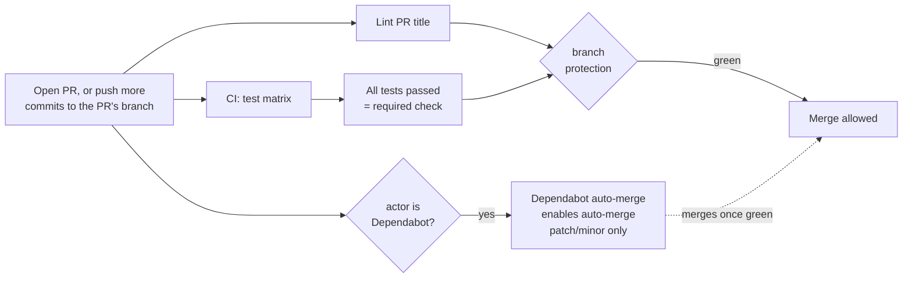
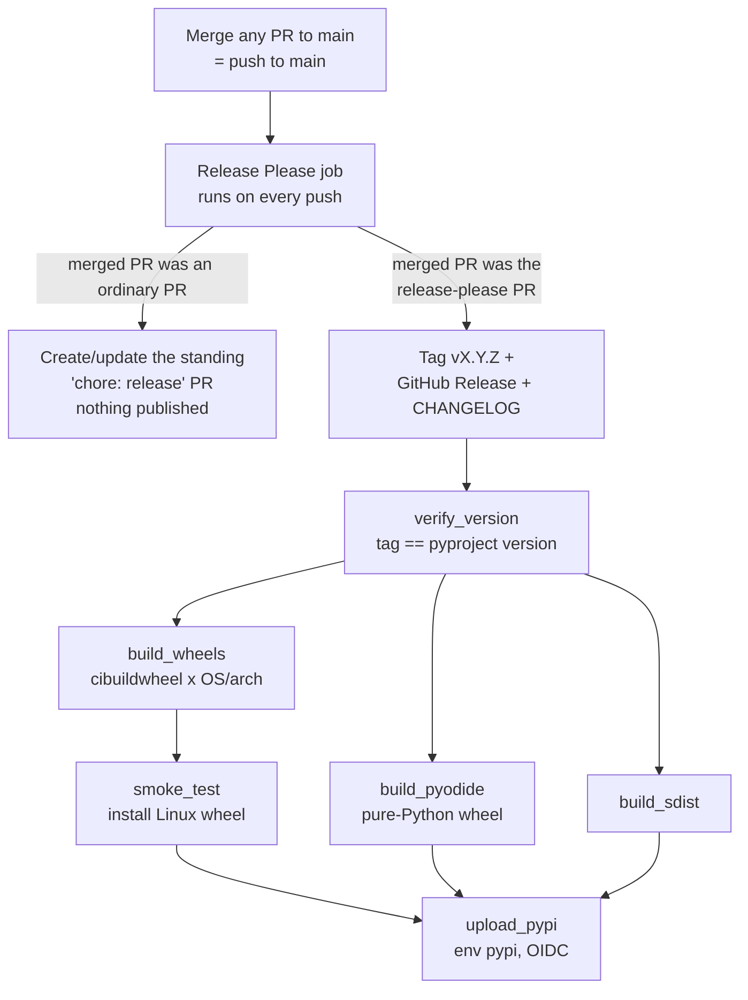
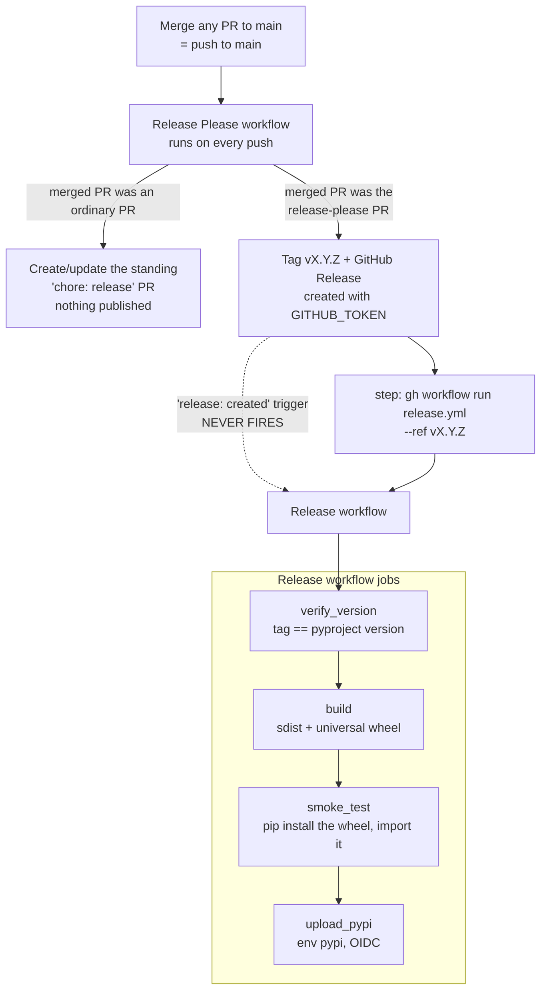
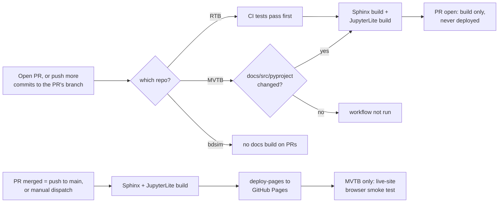
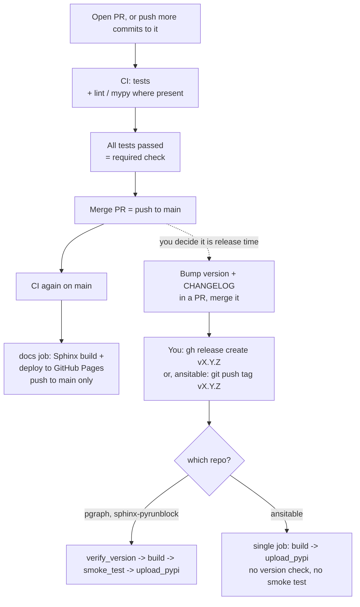

# CI cheatsheet — what happens when I do X

> Snapshot taken **2026-10-16** from each repo's `origin/main` (`origin/master` for SMTB)
> workflow files, `gh` run history and the GitHub settings API. **RTB was re-checked on
> 2026-10-23, and what changed is marked ▲**; the other repos are as of 16 October. Workflows drift: if this
> disagrees with a repo's `.github/workflows/*.yml`, the YAML wins — and this file needs
> updating. Scope: RTB, MVTB, bdsim in full; ansitable, pgraph-python, sphinx-pyrunblock,
> SMTB, Swift and SG more lightly. Where a call-out is in a third-party repo (SMTB, Swift,
> SG) it is an observation, not an instruction — changes go via PR to their owners.

---

## 1. Vocabulary (5 minutes)

### First: branch, PR, merge

A **branch** is a named line of commits. `main` is the official one: what is released and
what the docs site shows. To change anything you never edit `main` directly. You make a
side branch (say `fix/foo`), commit your work to it, and **push** it to GitHub.

A **pull request (PR)** is a request to merge that side branch into `main`. So a PR *is* a
branch plus a discussion page and a set of checks. When this document says:

* **"open a PR"**: you create that page for your side branch. CI starts.
* **"push more commits to the PR's branch"** or **"push more commits to the PR"**: you add commits to the
  *same side branch* while the PR is open. The PR updates and CI runs again. You do not make
  a new PR.
* **"merge the PR"**: the side branch's commits are added to `main`. To GitHub that is a
  *push to `main`*, and it is the event that deploys docs and drives releases.

In short: **branch = your work in progress, PR = asking to land it, merge = it lands on `main`.**
Checks run on the first two. Publishing happens on the third.

| Term | What it is |
| :--- | :--- |
| **Workflow** | One YAML file in `.github/workflows/`. Has a `name:` (shown in the Actions tab and PR checks) which is often *different* from the filename. |
| **Trigger** (`on:`) | What starts it: `push`, `pull_request`, `release`, `workflow_dispatch` (the "Run workflow" button), `schedule` (cron), `workflow_call` (another workflow calls it), `workflow_run` (after another workflow finishes). |
| **Job** | A box inside a workflow that runs on one machine. Jobs run in parallel unless one `needs:` another. |
| **Workflow artifact** | A temporary file passed between jobs or downloadable from a run (`upload-artifact`). Expires; not public. |
| **Release asset** | A file attached to a GitHub Release page (e.g. `bdsim_examples.zip`). Permanent and public. Not the same thing as the above. |
| **Required check** | A job name that branch protection insists is green before a PR can merge. On all three of the big 3 this is the single job **`All tests passed`**. |
| **Environment** | A named gate (`pypi`, `github-pages`) with its own rules. `pypi` only accepts deploys from tags matching `v*`. |
| **Trusted publishing (OIDC)** | PyPI trusts the GitHub workflow itself; there is no stored PyPI token to leak or expire. |

Three bots/services that are **not** workflows you wrote, but act on them:

* **release-please** — a GitHub Action (inside your workflow) that reads Conventional
  Commit messages on `main`, keeps a standing "release PR" up to date, and when that PR is
  merged creates the version tag, the GitHub Release and the CHANGELOG entry.
* **Dependabot** — GitHub's own service, configured by `.github/dependabot.yml`. It opens PRs
  bumping GitHub Actions versions (monthly). Pip dependencies are *not* watched (see §6).
* **Codecov / Codacy** — outside services. Codecov receives a coverage upload *from* a
  workflow; Codacy's code analysis is a GitHub App (not visible in any YAML) and its
  coverage upload is only wired in bdsim's `ci.yml`.

---

## 2. The map: I do this → what fires → what comes out

"Big 3" = RTB, MVTB, bdsim. Differences between them are called out in the cell.

| # | I do this | Moving parts activated | Outputs |
| :-: | :--- | :--- | :--- |
| 1 | **Open a PR, or push more commits to the PR's branch** (GitHub event: `pull_request`) | `CI` (test matrix → **All tests passed**; plus mypy/coverage in RTB, pgraph-compat in MVTB). ▲ In RTB the gate is `test-core` (Linux, fast tests) and the `test` matrix (3 OS × Python 3.10–3.14), nothing else: `mypy`, `coverage` and the docs build are separate jobs that are **not** part of it, and `coverage` only starts after the tests finish. `Lint PR title` (Conventional Commits). Docs *build* only, no deploy: RTB (after tests pass), MVTB (only if `docs/`, `src/`, `packages/mvtb-data/` or `pyproject.toml` changed). **bdsim: no docs build on PRs.** If actor is Dependabot: `Dependabot auto-merge`. | Green/red checks on the PR. Codecov comment (bdsim; ▲ RTB no longer comments, its Codecov statuses are informational, see `.github/codecov.yml`). Nothing published. A first-time contributor's PR waits for a maintainer to approve the workflow run. |
| 2 | **Merge a PR to `main`** (GitHub event: `push` to `main`; the ordinary case) | `CI` again on `main`. `Release Please` (updates the standing release PR). `Docs Publish` (MVTB: only if docs-related paths changed; bdsim: always; RTB: as the `docs` job *inside* `CI`, after tests pass). bdsim only: `Package Artifacts`. | Docs site redeployed to GitHub Pages (incl. JupyterLite). bdsim: zips attached to the rolling `latest-main` release. A new/updated "chore: release X.Y.Z" PR appears. **No PyPI upload.** |
| 3 | **Merge the release-please PR** (this *is* "doing a release") | Everything in row 2, **plus** release-please creates the tag `vX.Y.Z` + GitHub Release, then the publish job runs: build wheels/sdist → smoke test → upload to PyPI via OIDC (environment `pypi`). RTB: all in one `Release` workflow run. MVTB/bdsim: `Release Please` *dispatches* `Release` at the tag. ▲ The release PR is made by a bot, so GitHub starts **no CI** on it, yet branch protection needs `All tests passed` and an up-to-date branch: run `gh pr update-branch <n>` (a push under your account starts CI), or close and reopen it, and repeat whenever `main` moves. Release-please changes its PR only for a releasable commit (`feat`, `fix`, `perf` ...); a `ci:` or `chore:` merge leaves it alone but makes it behind. | PyPI release. GitHub Release + CHANGELOG. Docs redeployed. RTB: pure-Python wheel for Pyodide/JupyterLite is on PyPI as a normal wheel. |
| 4 | **Click "Run workflow" on `Docs Publish`** | Docs build + deploy only, skipping the test matrix. (RTB: `docs-publish.yml` calls the reusable `docs.yml`. MVTB/bdsim: the same workflow that runs on push.) Deploys only when run on `main`. | Docs site redeployed. |
| 5 | **Click "Run workflow" on `Release`** | Rebuild + republish. Version-vs-tag check is skipped (no fresh tag). RTB's upload uses `skip-existing: true`; MVTB and bdsim don't, so re-running on an already-published version fails at the upload step. | PyPI upload attempt for the current version. |
| 6 | **Push a tag `rtb-data-v*`** (RTB only) | `Release rtb-data` — independently versioned PyPI project. | `rtb-data` on PyPI. |
| 7 | **Do nothing, wait for Monday** (MVTB only) | `JupyterLite smoke test` on cron (Mon 21:17 UTC), also after every successful `Docs Publish` on `main`. Opens the *live* site in Chromium + WebKit and runs a notebook's bootstrap cell. | Failing run + notification if a PyPI dependency broke the browser install. Cannot block a deploy. |
| 8 | **Dependabot opens a PR** (monthly) | Rows 1's checks, then `Dependabot auto-merge` enables auto-merge for patch/minor bumps once required checks pass. | Merged action bump, no human. Major bumps wait for you. |
| 9 | **Create a GitHub Release by hand** (SMTB, Swift, SG, ansitable, pgraph, sphinx-pyrunblock) | `release: created`/`published` triggers the PyPI workflow directly (these repos don't use release-please). A human-created release *does* fire event triggers; one created by `GITHUB_TOKEN` does not — see §5.1. | PyPI release; Swift/SG build wheels on all platforms (cibuildwheel). |

> **Two different moments, two different sets of workflows.** *Opening or updating* a PR
> runs checks only and publishes nothing. *Merging* it is a `push` to `main`, which is what
> deploys docs and drives releases. "PR" alone is ambiguous below; each use says which.

### Reading the map: "merging a PR fires four things"

That is the confusing bit. One merge to `main` triggers `CI`, `Release Please`, `Docs Publish`
(and in bdsim `Package Artifacts`) as **independent, parallel workflows**. They don't wait for
each other (except RTB, where docs is a job after tests). Only `Release Please` decides
whether this particular merge is a release.

---

## 3. Diagrams

### 3.1 Opening a PR (or pushing more commits to it), up to the merge button



### 3.2 Release, RTB (single workflow)

The `Release Please` job runs on **every** push to `main`. Whether that push becomes a
release depends on what was merged: an ordinary PR just refreshes the standing release PR;
merging *the release PR itself* is what cuts the release.



▲ **Before merging the release PR (RTB checklist, from the 1.5.0 release).** The publish step cannot be
undone, so everything before it is rehearsed: (1) the release branch is level with `main` and the PR's diff
is only the version, the manifest and the CHANGELOG; (2) its CI is green, which needs the nudge in row 3;
(3) from a clean clone of that branch, build the sdist, the pure wheel (`RTB_PURE_WHEEL=1`, which must be
tagged `py3-none-any`) and a native wheel, run `twine check`, install each into a fresh venv (check its
`sys.prefix` first), and run the test suite against the *installed* wheel; (4) diff `release.yml` against
the previous release tag. Not rehearsable: the other platforms' wheels (every PR's CI builds them) and the
PyPI upload.

### 3.3 Release, MVTB and bdsim (two workflows + a dispatch)

Same two-way split at the top as RTB. MVTB and bdsim are **pure Python**, so there is no
cibuildwheel matrix and no separate Pyodide wheel: one `build` job makes the sdist and one
universal wheel. Their `release.yml` files differ by two lines (package name and import
name in the smoke test); `release-please.yml` differs only in one `gh` flag.



The dotted path is why the explicit dispatch step exists: GitHub deliberately does not let
events caused by `GITHUB_TOKEN` start *other* workflows. RTB fixed this by merging both
workflows into one (v1.4.0 incident, 2026-08-23); MVTB and bdsim still use the dispatch
workaround. The dispatch picks the tag with `gh release list --limit 1` (newest release by
creation date), which in bdsim sits alongside the rolling `latest-main` release (§5.1): worth
checking it can never choose that one, as `pypi` rejects non-`v*` refs.

### 3.4 Docs and JupyterLite



A docs build that fails on a PR shows as a red check, but it is not a *required* check
(only `All tests passed` is), so it does not block the merge.

### 3.5 Everything else: ansitable, pgraph-python, sphinx-pyrunblock (manual releases)

These repos have **no release-please and no PR-title lint**. A release is something you do
by hand, in this order:

1. Edit the version in `pyproject.toml` and write the `CHANGELOG.md` entry, in a normal PR; merge it.
2. Create the release: `gh release create vX.Y.Z` (or the GitHub UI) on `main`. ansitable
   instead just pushes a tag `vX.Y.Z`.
3. Because *you* created it (not `GITHUB_TOKEN`), the `release: created` trigger **does** fire.



Differences worth knowing: pgraph's `publish.yml` additionally checks the tagged commit is
on `main` (the only workflow of the six I read that does); sphinx-pyrunblock listens for both
`created` and `published` after seeing one fire without the other; ansitable's workflow is
named `publish` and its filename is `release.yml`. All three have the `All tests passed`
required check on `main`. ansitable and pgraph build docs as a job inside `CI`;
sphinx-pyrunblock has a separate `docs.yml` that also builds on PRs.

---

## 4. Workflow-by-workflow reference (same job, different names)

| Job | RTB | MVTB | bdsim | Others |
| :--- | :--- | :--- | :--- | :--- |
| Tests | `ci.yml` "CI" | `ci.yml` "CI" | `ci.yml` "CI" | ansitable `master.yml` "CI"; pgraph `ci.yml`; SMTB `master.yml` "build"; Swift `python-tests.yml` "CI"; SG `build.yml` "CI" |
| Required gate | job "All tests passed" | same | same | present in ansitable, pgraph, sphinx-pyrunblock; not verified elsewhere |
| PR title lint | `commitlint.yml` | same | same | — |
| Dependabot auto-merge | `dependabot-auto-merge.yml` | same | same | identical file in ansitable, pgraph, sphinx-pyrunblock |
| Release PR / tagging | in `release.yml` | `release-please.yml` | `release-please.yml` | none (manual) |
| PyPI publish | `release.yml` (+ `release-rtb-data.yml`) | `release.yml` | `release.yml` | ansitable `release.yml` (named "publish", on tag push); pgraph `publish.yml`; SMTB `publish.yml`; Swift/SG `cibuildwheel.yml` |
| Docs deploy | `docs.yml` (reusable) via `ci.yml`; `docs-publish.yml` manual | `docs.yml`, named **"Docs Publish"** | `pages.yml`, named **"Docs Publish"** | ansitable/pgraph/SG: a job inside CI; sphinx-pyrunblock `docs.yml`; SMTB `sphinx.yml`; Swift `docs.yml` |
| Release zips | — (none) | — | `publish.yml` "Package Artifacts" | — |
| Coverage | Codecov in `ci.yml` ▲ (measures the *installed* package: `[tool.coverage.paths]` maps it back to `src/`; `.github/codecov.yml`: no PR comment, informational statuses) | Codecov, push only | Codecov **and** Codacy |
| Static analysis | ▲ Codacy (GitHub App; `.codacy.yml` skips Bandit in `tests/`, the hardware sketches, the vendored Eigen, and pyflakes star imports in `tests/` and `examples/`) | not checked | Codacy (coverage upload wired in `ci.yml`) | — | pgraph, SMTB, SG: Codecov |
| Live JupyterLite check | — | `lite-smoke.yml` | — | — |

Repo-settings facts (verified via `gh api`, 2026-10-16): the big 3 each have branch protection
on `main` requiring **All tests passed** (no required reviews), environments `github-pages`
and `pypi`, and Pages built from a workflow. *Not verified* (needs admin): ansitable,
pgraph, sphinx-pyrunblock protection settings, and anything on SMTB/Swift/SG.

---

## 5. Needless complexity and bugs — call-outs

Ordered by how much they should bother you. Per repo policy these should be logged as
`tech-debt` issues rather than fixed on this branch.

### 5.1 BUG — bdsim: versioned releases never get their zips, and "Latest" is the rolling build

`publish.yml` attaches `bdsim_examples.zip`/`bdsim_notebooks.zip` on `release: published`.
That event never fires for a release created by release-please (same `GITHUB_TOKEN`
restriction as §3.3). Evidence: release `v1.4.0` has **no assets**; only the rolling
`latest-main` release has them. Worse, `latest-main` is created with `make_latest: true`, so
`/releases/latest` and `gh release view` point at a rolling "build from main", not at
`v1.4.0`. Fix: attach the zips from the release workflow (RTB-style, same run) and drop
`make_latest` from the rolling release (or stop using a GitHub Release for the rolling build).

### 5.2 DEAD CODE / TRAP — MVTB and bdsim `release.yml` `on: release: created`

Because of §3.3 this trigger never fires after a release-please release; the only working
path is the dispatch in `release-please.yml`. It *would* fire for a hand-made release,
producing a second publish path that nobody tests. RTB removed the problem by merging the two
workflows. Recommendation: do the same in MVTB and bdsim, which also removes the
"dispatch at the tag because the `pypi` environment only allows `v*` refs" folklore from
three comment blocks. (Note MVTB's Release workflow history is *all* `workflow_dispatch`.)

### 5.3 Naming drift — one concept, many names

"Publish the docs" is `docs.yml` named "Docs Publish" (MVTB), `pages.yml` named "Docs
Publish" (bdsim), `docs.yml` named "Docs" + `docs-publish.yml` named "Docs Publish" (RTB).
"Publish to PyPI" is `release.yml` almost everywhere but `publish.yml` in pgraph/SMTB; and
in bdsim `publish.yml` means *release zips*. Name-matching is how you find things; this is
the biggest day-to-day cost. Suggest one convention: `ci.yml`, `docs.yml`, `release.yml`,
`assets.yml`, with `name:` equal to the filename stem title-cased.

### 5.3b bdsim does not build docs on PRs

A broken Sphinx or JupyterLite build in bdsim is only discovered after merge, when `Docs Publish` runs on `main`. RTB and MVTB catch it on the PR. Suggest adding `pull_request` to `pages.yml` (build only; the deploy job is already gated on `refs/heads/main`).

### 5.4 Heavy conditional logic in RTB `release.yml`

One file mixes release-please, manual dispatch and publish, hence repeated
`always() && needs.X.result == 'success'` guards (skipped `needs` otherwise auto-skip
dependents). It works and is documented, but is the hardest file in the ecosystem to read.
Acceptable; worth a section in this doc's §3.2 diagram rather than a rewrite.

### 5.5 Copy-paste duplication — six copies of `dependabot-auto-merge.yml`

Byte-identical in RTB, MVTB, bdsim, ansitable, pgraph, sphinx-pyrunblock. Also each repo
logs 9–21 *skipped* "Dependabot auto-merge" runs for every human PR. Candidates: a reusable
workflow in `rvc-ecosystem` (`uses: petercorke/rvc-ecosystem/.github/workflows/...@v1`), or
leave as is — it's tiny. Low priority.

### 5.6 Question, not a bug — Dependabot only watches GitHub Actions

All repos' `dependabot.yml` have a single ecosystem, `github-actions`, monthly. Python
dependency bumps (pip) are not proposed. Intentional? For libraries with loose lower-bound
pins that is defensible; for CI-only tools (docs requirements, mypy) it means drift
unnoticed. Worth a deliberate decision.

### 5.7 JupyterLite: MVTB does far more than RTB or bdsim (checks are justified, packaging is not)

Measured 2026-10-16 from each `docs` workflow and `docs/lite/`:

| Step | RTB | MVTB | bdsim |
| :--- | :--- | :--- | :--- |
| Local wheel for the Lite site | pure `py3-none-any` wheel (`RTB_PURE_WHEEL=1`) | `python -m build --wheel` | `python -m build` plus `gen_index.py` (writes a piplite index `all.json`) |
| Copy notebooks in | `rsync` with excludes | `find`/`cp` loop with excludes | `cp *.ipynb` |
| Adapt notebooks for Pyodide | inline Python: set kernelspec | inline Python: set kernelspec **and** rewrite `%matplotlib ipympl` to `inline` | no adapt step in the workflow (`adapt_nb.py` exists in `docs/lite/`, not checked where used) |
| Pre-build checks | none | notebook bootstrap cells/outputs in sync (`sync_bootstrap.py --check`, `clear_outputs.py --check`) | none |
| Does it actually work? | none | real Pyodide install in Node (`wasm_check/`, own `package-lock.json`); real Chromium **and** WebKit start-up check before deploy (`browser_check/`); the same browser script against the **live** site after every deploy and weekly (`lite-smoke.yml`) | only checks a Pyodide kernel directory exists in the output |
| Size of the Lite machinery in `docs/lite/` | 2 config files | 8 files (about 280 lines of Node/Python checks) | 8 files (Makefile, local server, index generator) |
| `jupyterlite-pyodide-kernel==0.6.1` pin | yes, long comment | yes, long comment | yes, long comment |

**Verdict.** The checks are not over the top. They exist because Lite breaks with no commit
in the repo (a PyPI dependency changes; bdsim hit exactly this, an intermittent
`ModuleNotFoundError` for matplotlib), and RTB and bdsim currently have *no* way to find
out until a user does. MVTB is ahead, not excessive. What is excessive is *where it lives*:

* **Logic in YAML.** About 40 lines of inline Python heredoc to adapt notebooks, copy-pasted
  with small differences in RTB and MVTB. It cannot be run locally and is untested.
  Move it to a script in `docs/lite/` (bdsim's `adapt_nb.py` is the right idea).
* **The same 15-line pin explanation, three times.** It should live in one place
  (this repo, or the maintainer skill) with a one-line pointer from each workflow.
* **Stale temporary flag.** The pre-deploy browser check in MVTB has `continue-on-error: true`
  with a comment saying to delete it once it has run green once on `main`. It has: the
  13 Oct 2026 22:22 UTC `Docs Publish` push run passed it. Delete the line so a failure blocks
  the deploy as intended.
* **Two layers run the same script.** `check_lite_in_browser.py` runs against a local copy
  before deploy and against the live site after. That is deliberate, not waste: the first
  can block a deploy, the second catches drift between deploys. Keep both.
* **Not shared.** If this tooling is worth having, RTB and bdsim should adopt it, ideally as
  a shared composite action or reusable workflow (§8) so the three do not diverge again.
  This also delivers the README aspiration of one consistent Lite setup across the big 3.

### 5.8 Minor inconsistencies

* release-please config location: `.github/release-please-config.json` (RTB) vs repo root (MVTB, bdsim).
* Codecov uploads on PRs and pushes (RTB) vs only on `push` to `main` (MVTB, `if: github.event_name == 'push'`), so MVTB gets no coverage delta on PRs.
* Codacy coverage is uploaded from bdsim only; badge/coverage grades elsewhere come from the Codacy app and won't match.
* Default branch `master` in SMTB (RAI's repo) — already known.
* MVTB's `lite-smoke.yml` is the only post-deploy live check; RTB and bdsim deploy JupyterLite with no equivalent. README's "consistent across the big 3" aspiration (§CI in README.md) would cover it.

### 5.9 ▲ RTB: the coverage job measured nothing (fixed 2026-10-23, RTB #897)

The job installs the package (`pip install .[dev]`), so the tests import the installed copy, but it measured
`--cov=src/roboticstoolbox`, a path that never runs: "No data was collected", an empty report, and Codecov
showing 0% on every commit of `main` (16,686 lines, 0 hits). Separately, Codecov's **default branch** was
still `master`, so its dashboard and the README badge showed 70.21% of 2023 code. Both are fixed: the package is
measured by name, and the real number is about 86%. **Check each repo:** the CI log must not say "No data was
collected", and Codecov's API (public) must show hits: `curl
https://api.codecov.io/api/v2/github/OWNER/repos/REPO/` gives the default `branch`, and `…/branches/main/`
the totals. Tracked in rvc-ecosystem #26.

### 5.10 ▲ Tests quietly left out: RTB `test_blocks.py`; MVTB `blocks/` coverage

RTB's `ci.yml` has had `--ignore=tests/test_blocks.py` since its first version (19 May 2026), with no comment.
It was inherited from the old workflow (`--ignore=roboticstoolbox/blocks`), from before `bdsim` was
installed in CI, though `bdsim` has been in the `dev` extras since 2023. Run in CI's environment the file
takes about 2 seconds (29 passed, 6 skipped) and would raise the coverage of `blocks/` from 34% to 73%. MVTB
omits its `blocks/` from coverage (`--omit`), which may be the same history. Every `--ignore`,
`--deselect` and `omit` needs a comment saying why it is still needed. Tracked in rvc-ecosystem #26.

### 5.11 ▲ RTB: CONTRIBUTING.md says `mypy` and the docs build are required; they are not

The only required check is `All tests passed`, and it depends on `test-core` and `test` alone. A failing `mypy`
or docs job shows red on a PR but does not block the merge. Either add them to the gate, or correct the
text in RTB's `.github/CONTRIBUTING.md` ("What the checks mean").

### 5.12 ▲ Third-party actions are referenced by a movable tag

`uses: owner/action@v6` runs whatever the tag points to that day; a tag can be moved by the author or by
anyone who takes over their account, and `release.yml` publishes to PyPI. RTB pinned its six third-party
actions to commit SHAs (with the version in a comment) on 2026-10-23, and Dependabot's `github-actions`
ecosystem updates a pinned SHA together with its comment. The other repos are in rvc-ecosystem #24. GitHub's
own `actions/*` stay on tags.

### 5.13 ▲ RTB: slow tests and the coverage job's cost

Tests marked `slow` (the analytic IK tests that compile generated C and C++, 9 of them, one 41 s) run only in
`coverage`, as the matrix jobs use `-m "not slow"`: on the Windows runner a compiler exists but is slow enough
to hit the 50 s limit. The cost is that `coverage` now takes about 25 minutes, runs on **every PR and every
push to `main`** (it has no `if:`), and `needs` the whole matrix before it starts. It is not a required check,
so it never blocks a merge. Speeding it up, or running it only on `main`, is RTB #898.

---

## 6. Things outside the YAML that matter

* **Branch protection** (Settings → Branches): required check `All tests passed`. A path-filtered
  workflow can never be a required check without blocking unrelated PRs — which is why docs
  isn't one.
* **Environment `pypi`**: allows only `v*` tags; PyPI side has a trusted-publisher entry
  naming the exact workflow file and environment. **Renaming `release.yml` breaks
  publishing** until PyPI is updated (relevant if §5.3 is acted on).
* **Pages**: source is "GitHub Actions" (workflow), not a branch.
* **Codacy / Codecov**: app installs and tokens live in their dashboards. ▲ Codecov: the repository's
  **default branch** is a setting there (Configuration → General, applied at once, no save button) and the
  dashboard and the README badge follow it. Uploads from RTB work **without** a token (its Codecov page says a
  token is not required); a `CODECOV_TOKEN` is only needed if that setting is changed. A token shown in a screenshot or
  a log is a secret: regenerate it. Codacy and Codecov both have public read APIs for a public repo, no token needed.
* **Required secrets**: none for PyPI (OIDC). `GITHUB_TOKEN` is automatic.

---

## 7. Cheat-sheet for the three commands you actually run

```bash
# what's running/last ran on a repo, by workflow
gh run list -R petercorke/bdsim -L 10

# watch a run
gh run watch -R petercorke/bdsim

# re-publish docs without a release
gh workflow run "Docs Publish" -R petercorke/robotics-toolbox-python --ref main

# is the release PR waiting for me?
gh pr list -R petercorke/machinevision-toolbox-python --search "chore: release in:title"

# ▲ the release PR is blocked with no checks: it is bot-made, so start CI under your account
gh pr update-branch 704 -R petercorke/robotics-toolbox-python     # when it is behind main
gh pr close 704 && gh pr reopen 704                                # or this, when it is level

# ▲ is Codecov showing real data, and for which branch?
curl -s https://api.codecov.io/api/v2/github/petercorke/repos/robotics-toolbox-python/ | python3 -m json.tool | grep -E '"branch"|coverage'
curl -s https://app.codacy.com/api/v3/analysis/organizations/gh/petercorke/repositories/robotics-toolbox-python | python3 -m json.tool | grep -E 'gradeLetter|issuesCount'
```

---

## 8. Could the workflow files be unified so they don't drift?

**Short answer: yes, in layers, and the evidence says it is worth it for part of it.**
Measured today: `commitlint.yml` is byte-identical in RTB, MVTB and bdsim;
`dependabot-auto-merge.yml` is byte-identical in six repos; MVTB's and bdsim's `release.yml`
differ by **two lines** (package name and import name). Those copies have already drifted in
*naming* even where the code matches (§5.3).

### What GitHub gives you

| Mechanism | What it shares | Update model | Fits |
| :--- | :--- | :--- | :--- |
| **Reusable workflow** (`on: workflow_call`) | A whole workflow, with inputs and secrets. Callers write `uses: petercorke/rvc-ecosystem/.github/workflows/pypi-release.yml@v1`. | Change once, tag `v1.x`, every caller picks it up. Dependabot's `github-actions` ecosystem (already enabled) proposes the bump PRs when callers are pinned to a tag or SHA. | Whole pipelines: PR-title lint, Dependabot auto-merge, pure-Python PyPI release. |
| **Composite action** | A reusable *sequence of steps* inside one job. | Same, via tag. | Repeated step groups, e.g. "build Sphinx and upload Pages artifact", "verify tag == pyproject version". |
| **Template repo / copy + drift check** | Nothing at runtime; each repo keeps its own copy. | A scheduled job in `rvc-ecosystem` diffs each repo's file against the master copy and opens an issue when they differ. | Files that must stay per-repo (e.g. `ci.yml`) but should keep the same shape and job names. |

(Org-level "starter workflows" and rulesets only apply inside a GitHub organization, not a
personal account's repos.)

### What can and cannot be shared here

| Piece | Share? | Why |
| :--- | :--- | :--- |
| `commitlint.yml`, `dependabot-auto-merge.yml` | **Yes, reusable workflow.** Each repo's copy shrinks to ~6 lines. | Identical today. Zero project-specific content. |
| Pure-Python PyPI release (`verify_version → build → smoke_test → upload_pypi`): MVTB, bdsim, pgraph, sphinx-pyrunblock; ansitable could adopt it | **Yes, reusable workflow** taking `package-name`, `import-name`. Also a natural place to add pgraph's "tag is on `main`" check for everyone. | Differs by two lines today. |
| `release-please.yml` (MVTB, bdsim) | **Yes**, or better: fold into the release workflow as RTB did, then share that. | Differs by one flag. |
| RTB release (cibuildwheel matrix + Pyodide wheel) | **No, keep bespoke.** Possibly share its smaller parts as composite actions. | Compiled extension, per-OS matrix; unique. |
| Docs build | **Only the deploy half.** The Pages upload/deploy job is shareable; the build steps (Sphinx extras, JupyterLite, notebook checks) are project-specific. | Build recipes differ in RTB/MVTB/bdsim. |
| `ci.yml` test matrices | **No.** Share only the *contract*: a final job named **`All tests passed`**, so branch protection is identical everywhere. | Python/OS/dependency matrices differ legitimately. |

### Trade-offs to decide with open eyes

* **One bug breaks every release at once.** A shared release workflow is a single point of
  failure; a bad change published as `v1` would hit all callers on their next release. Mitigate
  by calling it by a pinned tag or SHA (Dependabot bumps it, so each repo adopts changes via
  a PR that runs its own checks), and by testing changes on `ansitable` first.
* **PyPI trusted publishing is bound to a specific workflow, repo and environment.** pgraph's
  `publish.yml` header records that: owner, repository, workflow file and environment `pypi`.
  With a reusable workflow, PyPI sees the *caller's* workflow identity, so each repo's
  caller file must keep the filename registered on PyPI. I have **not verified** this
  against current PyPI behaviour; it must be tested on a throwaway project before any repo's
  release path is moved, and it is the main reason not to rename files lightly (§6).
* **Third-party repos (SMTB, Swift, SG)** can call a shared workflow but we can only propose
  it via PR; leave them out of scope.
* **Where the shared files live.** `rvc-ecosystem` is public and owned by a personal account, so every repo can call workflows in it. The open design question is whether to host them here or in a dedicated repo, so release tags like `v1` for the workflows are not mixed with docs commits.

### Suggested order, cheapest and safest first

1. **Names and job contract first** (no sharing yet): one filename convention and the
   `All tests passed` job in every repo. This alone removes most day-to-day confusion.
2. **Share `commitlint` and `dependabot-auto-merge`** as reusable workflows. Pure win, no
   PyPI involvement.
3. **Merge MVTB's and bdsim's release-please + release into RTB's single-workflow shape**
   (fixes §5.1/§5.2), *then* extract that as a shared pure-Python release workflow once the
   PyPI trusted-publisher behaviour has been tested.
4. Add a **drift check** in `rvc-ecosystem` for what stays per-repo.
