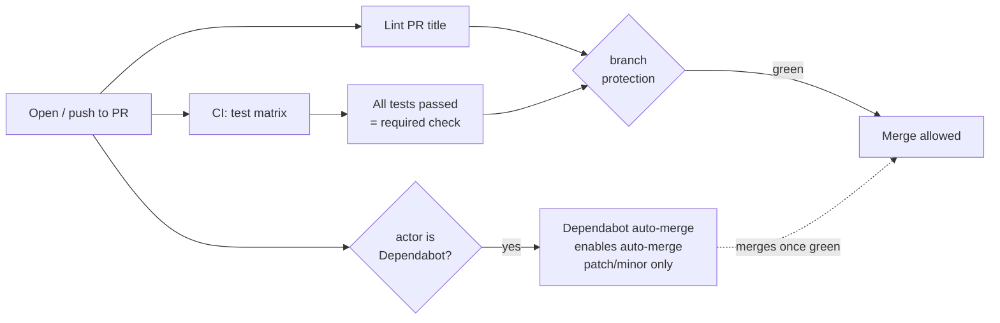
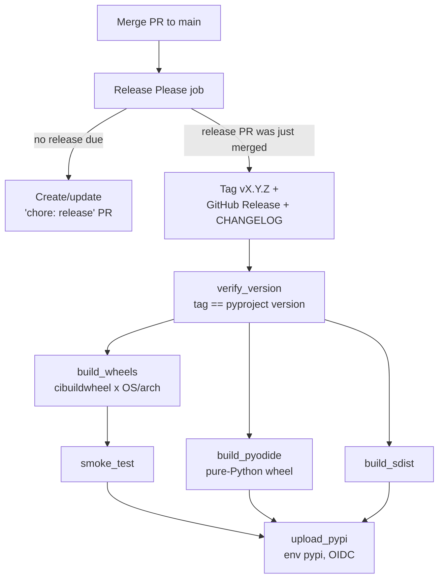
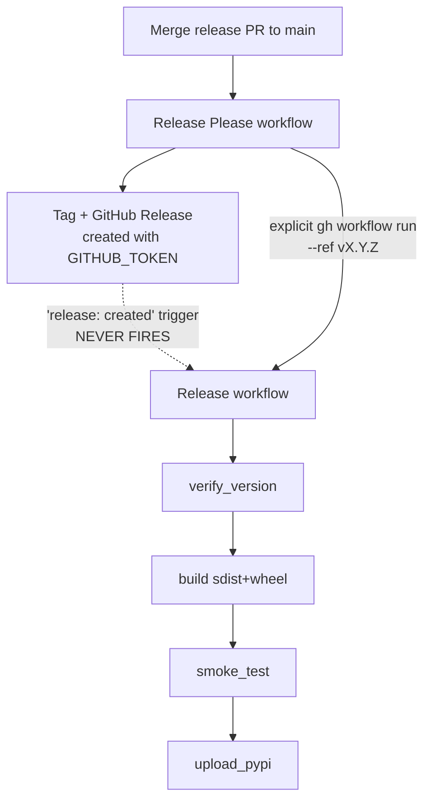
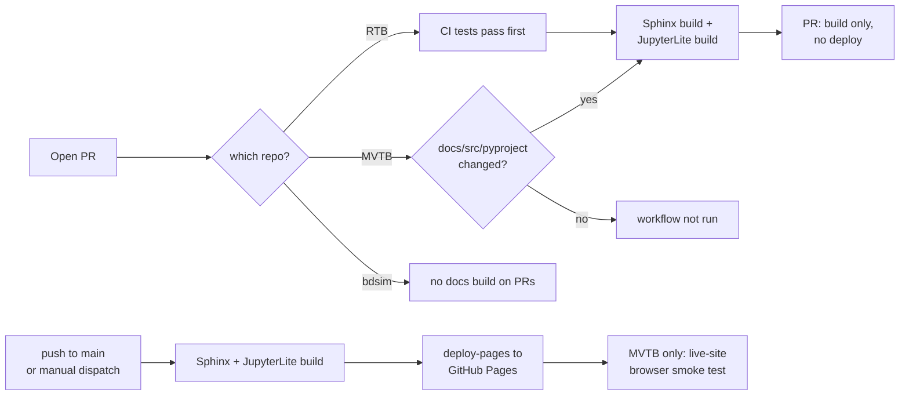

# CI cheatsheet — what happens when I do X

> Snapshot taken **2026-10-16** from each repo's `origin/main` (`origin/master` for SMTB)
> workflow files, `gh` run history and the GitHub settings API. Workflows drift: if this
> disagrees with a repo's `.github/workflows/*.yml`, the YAML wins — and this file needs
> updating. Scope: RTB, MVTB, bdsim in full; ansitable, pgraph-python, sphinx-pyrunblock,
> SMTB, Swift and SG more lightly. Where a call-out is in a third-party repo (SMTB, Swift,
> SG) it is an observation, not an instruction — changes go via PR to their owners.

---

## 1. Vocabulary (5 minutes)

| Term | What it is |
| :--- | :--- |
| **Workflow** | One YAML file in `.github/workflows/`. Has a `name:` (shown in the Actions tab and PR checks) which is often *different* from the filename. |
| **Trigger** (`on:`) | What starts it: `push`, `pull_request`, `release`, `workflow_dispatch` (the "Run workflow" button), `schedule` (cron), `workflow_call` (another workflow calls it), `workflow_run` (after another workflow finishes). |
| **Job** | A box inside a workflow that runs on one machine. Jobs run in parallel unless one `needs:` another. |
| **Workflow artifact** | A temporary file passed between jobs or downloadable from a run (`upload-artifact`). Expires; not public. |
| **Release asset** | A file attached to a GitHub Release page (e.g. `bdsim_examples.zip`). Permanent and public. Not the same thing as the above. |
| **Required check** | A job name that branch protection insists is green before a PR can merge. On all three of the big 3 this is the single job **`All tests passed`**. |
| **Environment** | A named gate (`pypi`, `github-pages`) with its own rules. `pypi` only accepts deploys from tags matching `v*`. |
| **Trusted publishing (OIDC)** | PyPI trusts the GitHub workflow itself; there is no stored PyPI token to leak or expire. |

Three bots/services that are **not** workflows you wrote, but act on them:

* **release-please** — a GitHub Action (inside your workflow) that reads Conventional
  Commit messages on `main`, keeps a standing "release PR" up to date, and when that PR is
  merged creates the version tag, the GitHub Release and the CHANGELOG entry.
* **Dependabot** — GitHub's own service, configured by `.github/dependabot.yml`. It opens PRs
  bumping GitHub Actions versions (monthly). Pip dependencies are *not* watched (see §6).
* **Codecov / Codacy** — outside services. Codecov receives a coverage upload *from* a
  workflow; Codacy's code analysis is a GitHub App (not visible in any YAML) and its
  coverage upload is only wired in bdsim's `ci.yml`.

---

## 2. The map: I do this → what fires → what comes out

"Big 3" = RTB, MVTB, bdsim. Differences between them are called out in the cell.

| # | I do this | Moving parts activated | Outputs |
| :-: | :--- | :--- | :--- |
| 1 | **Open a PR** (or push to its branch) | `CI` (test matrix → **All tests passed**; plus mypy/coverage in RTB, pgraph-compat in MVTB). `Lint PR title` (Conventional Commits). Docs *build* only, no deploy: RTB (after tests pass), MVTB (only if `docs/`, `src/`, `packages/mvtb-data/` or `pyproject.toml` changed). **bdsim: no docs build on PRs.** If actor is Dependabot: `Dependabot auto-merge`. | Green/red checks on the PR. Codecov comment (RTB, bdsim). Nothing published. |
| 2 | **Merge a PR to `main`** (the ordinary case) | `CI` again on `main`. `Release Please` (updates the standing release PR). `Docs Publish` (MVTB: only if docs-related paths changed; bdsim: always; RTB: as the `docs` job *inside* `CI`, after tests pass). bdsim only: `Package Artifacts`. | Docs site redeployed to GitHub Pages (incl. JupyterLite). bdsim: zips attached to the rolling `latest-main` release. A new/updated "chore: release X.Y.Z" PR appears. **No PyPI upload.** |
| 3 | **Merge the release-please PR** (this *is* "doing a release") | Everything in row 2, **plus** release-please creates the tag `vX.Y.Z` + GitHub Release, then the publish job runs: build wheels/sdist → smoke test → upload to PyPI via OIDC (environment `pypi`). RTB: all in one `Release` workflow run. MVTB/bdsim: `Release Please` *dispatches* `Release` at the tag. | PyPI release. GitHub Release + CHANGELOG. Docs redeployed. RTB: pure-Python wheel for Pyodide/JupyterLite is on PyPI as a normal wheel. |
| 4 | **Click "Run workflow" on `Docs Publish`** | Docs build + deploy only, skipping the test matrix. (RTB: `docs-publish.yml` calls the reusable `docs.yml`. MVTB/bdsim: the same workflow that runs on push.) Deploys only when run on `main`. | Docs site redeployed. |
| 5 | **Click "Run workflow" on `Release`** | Rebuild + republish. Version-vs-tag check is skipped (no fresh tag). RTB's upload uses `skip-existing: true`; MVTB and bdsim don't, so re-running on an already-published version fails at the upload step. | PyPI upload attempt for the current version. |
| 6 | **Push a tag `rtb-data-v*`** (RTB only) | `Release rtb-data` — independently versioned PyPI project. | `rtb-data` on PyPI. |
| 7 | **Do nothing, wait for Monday** (MVTB only) | `JupyterLite smoke test` on cron (Mon 21:17 UTC), also after every successful `Docs Publish` on `main`. Opens the *live* site in Chromium + WebKit and runs a notebook's bootstrap cell. | Failing run + notification if a PyPI dependency broke the browser install. Cannot block a deploy. |
| 8 | **Dependabot opens a PR** (monthly) | Rows 1's checks, then `Dependabot auto-merge` enables auto-merge for patch/minor bumps once required checks pass. | Merged action bump, no human. Major bumps wait for you. |
| 9 | **Create a GitHub Release by hand** (SMTB, Swift, SG, ansitable, pgraph, sphinx-pyrunblock) | `release: created`/`published` triggers the PyPI workflow directly (these repos don't use release-please). A human-created release *does* fire event triggers; one created by `GITHUB_TOKEN` does not — see §5.1. | PyPI release; Swift/SG build wheels on all platforms (cibuildwheel). |

### Reading the map: "merging a PR fires four things"

That is the confusing bit. One merge to `main` triggers `CI`, `Release Please`, `Docs Publish`
(and in bdsim `Package Artifacts`) as **independent, parallel workflows**. They don't wait for
each other (except RTB, where docs is a job after tests). Only `Release Please` decides
whether this particular merge is a release.

---

## 3. Diagrams

### 3.1 What a PR passes through



### 3.2 Release, RTB (single workflow)



### 3.3 Release, MVTB and bdsim (two workflows + a manual-looking dispatch)



The dotted path is why the explicit dispatch step exists: GitHub deliberately does not let
events caused by `GITHUB_TOKEN` start *other* workflows. RTB fixed this by merging both
workflows into one (v1.4.0 incident, 2026-08-23); MVTB and bdsim still use the dispatch
workaround.

### 3.4 Docs and JupyterLite



A docs build that fails on a PR shows as a red check, but it is not a *required* check
(only `All tests passed` is), so it does not block the merge.

---

## 4. Workflow-by-workflow reference (same job, different names)

| Job | RTB | MVTB | bdsim | Others |
| :--- | :--- | :--- | :--- | :--- |
| Tests | `ci.yml` "CI" | `ci.yml` "CI" | `ci.yml` "CI" | ansitable `master.yml` "CI"; pgraph `ci.yml`; SMTB `master.yml` "build"; Swift `python-tests.yml` "CI"; SG `build.yml` "CI" |
| Required gate | job "All tests passed" | same | same | present in ansitable, pgraph, sphinx-pyrunblock; not verified elsewhere |
| PR title lint | `commitlint.yml` | same | same | — |
| Dependabot auto-merge | `dependabot-auto-merge.yml` | same | same | identical file in ansitable, pgraph, sphinx-pyrunblock |
| Release PR / tagging | in `release.yml` | `release-please.yml` | `release-please.yml` | none (manual) |
| PyPI publish | `release.yml` (+ `release-rtb-data.yml`) | `release.yml` | `release.yml` | ansitable `release.yml` (named "publish", on tag push); pgraph `publish.yml`; SMTB `publish.yml`; Swift/SG `cibuildwheel.yml` |
| Docs deploy | `docs.yml` (reusable) via `ci.yml`; `docs-publish.yml` manual | `docs.yml`, named **"Docs Publish"** | `pages.yml`, named **"Docs Publish"** | ansitable/pgraph/SG: a job inside CI; sphinx-pyrunblock `docs.yml`; SMTB `sphinx.yml`; Swift `docs.yml` |
| Release zips | — (none) | — | `publish.yml` "Package Artifacts" | — |
| Coverage | Codecov in `ci.yml` | Codecov, push only | Codecov **and** Codacy | pgraph, SMTB, SG: Codecov |
| Live JupyterLite check | — | `lite-smoke.yml` | — | — |

Repo-settings facts (verified via `gh api`, 2026-10-16): the big 3 each have branch protection
on `main` requiring **All tests passed** (no required reviews), environments `github-pages`
and `pypi`, and Pages built from a workflow. *Not verified* (needs admin): ansitable,
pgraph, sphinx-pyrunblock protection settings, and anything on SMTB/Swift/SG.

---

## 5. Needless complexity and bugs — call-outs

Ordered by how much they should bother you. Per repo policy these should be logged as
`tech-debt` issues rather than fixed on this branch.

### 5.1 BUG — bdsim: versioned releases never get their zips, and "Latest" is the rolling build

`publish.yml` attaches `bdsim_examples.zip`/`bdsim_notebooks.zip` on `release: published`.
That event never fires for a release created by release-please (same `GITHUB_TOKEN`
restriction as §3.3). Evidence: release `v1.4.0` has **no assets**; only the rolling
`latest-main` release has them. Worse, `latest-main` is created with `make_latest: true`, so
`/releases/latest` and `gh release view` point at a rolling "build from main", not at
`v1.4.0`. Fix: attach the zips from the release workflow (RTB-style, same run) and drop
`make_latest` from the rolling release (or stop using a GitHub Release for the rolling build).

### 5.2 DEAD CODE / TRAP — MVTB and bdsim `release.yml` `on: release: created`

Because of §3.3 this trigger never fires after a release-please release; the only working
path is the dispatch in `release-please.yml`. It *would* fire for a hand-made release,
producing a second publish path that nobody tests. RTB removed the problem by merging the two
workflows. Recommendation: do the same in MVTB and bdsim, which also removes the
"dispatch at the tag because the `pypi` environment only allows `v*` refs" folklore from
three comment blocks. (Note MVTB's Release workflow history is *all* `workflow_dispatch`.)

### 5.3 Naming drift — one concept, many names

"Publish the docs" is `docs.yml` named "Docs Publish" (MVTB), `pages.yml` named "Docs
Publish" (bdsim), `docs.yml` named "Docs" + `docs-publish.yml` named "Docs Publish" (RTB).
"Publish to PyPI" is `release.yml` almost everywhere but `publish.yml` in pgraph/SMTB; and
in bdsim `publish.yml` means *release zips*. Name-matching is how you find things; this is
the biggest day-to-day cost. Suggest one convention: `ci.yml`, `docs.yml`, `release.yml`,
`assets.yml`, with `name:` equal to the filename stem title-cased.

### 5.3b bdsim does not build docs on PRs

A broken Sphinx or JupyterLite build in bdsim is only discovered after merge, when `Docs Publish` runs on `main`. RTB and MVTB catch it on the PR. Suggest adding `pull_request` to `pages.yml` (build only; the deploy job is already gated on `refs/heads/main`).

### 5.4 Heavy conditional logic in RTB `release.yml`

One file mixes release-please, manual dispatch and publish, hence repeated
`always() && needs.X.result == 'success'` guards (skipped `needs` otherwise auto-skip
dependents). It works and is documented, but is the hardest file in the ecosystem to read.
Acceptable; worth a section in this doc's §3.2 diagram rather than a rewrite.

### 5.5 Copy-paste duplication — six copies of `dependabot-auto-merge.yml`

Byte-identical in RTB, MVTB, bdsim, ansitable, pgraph, sphinx-pyrunblock. Also each repo
logs 9–21 *skipped* "Dependabot auto-merge" runs for every human PR. Candidates: a reusable
workflow in `rvc-ecosystem` (`uses: petercorke/rvc-ecosystem/.github/workflows/...@v1`), or
leave as is — it's tiny. Low priority.

### 5.6 Question, not a bug — Dependabot only watches GitHub Actions

All repos' `dependabot.yml` have a single ecosystem, `github-actions`, monthly. Python
dependency bumps (pip) are not proposed. Intentional? For libraries with loose lower-bound
pins that is defensible; for CI-only tools (docs requirements, mypy) it means drift
unnoticed. Worth a deliberate decision.

### 5.7 Minor inconsistencies

* release-please config location: `.github/release-please-config.json` (RTB) vs repo root (MVTB, bdsim).
* Codecov uploads on PRs and pushes (RTB) vs only on `push` to `main` (MVTB, `if: github.event_name == 'push'`), so MVTB gets no coverage delta on PRs.
* Codacy coverage is uploaded from bdsim only; badge/coverage grades elsewhere come from the Codacy app and won't match.
* Default branch `master` in SMTB (RAI's repo) — already known.
* MVTB's `lite-smoke.yml` is the only post-deploy live check; RTB and bdsim deploy JupyterLite with no equivalent. README's "consistent across the big 3" aspiration (§CI in README.md) would cover it.

---

## 6. Things outside the YAML that matter

* **Branch protection** (Settings → Branches): required check `All tests passed`. A path-filtered
  workflow can never be a required check without blocking unrelated PRs — which is why docs
  isn't one.
* **Environment `pypi`**: allows only `v*` tags; PyPI side has a trusted-publisher entry
  naming the exact workflow file and environment. **Renaming `release.yml` breaks
  publishing** until PyPI is updated (relevant if §5.3 is acted on).
* **Pages**: source is "GitHub Actions" (workflow), not a branch.
* **Codacy / Codecov**: app installs and tokens live in their dashboards; Codecov upload
  needs `CODECOV_TOKEN` secret in the repo.
* **Required secrets**: none for PyPI (OIDC). `GITHUB_TOKEN` is automatic.

---

## 7. Cheat-sheet for the three commands you actually run

```bash
# what's running/last ran on a repo, by workflow
gh run list -R petercorke/bdsim -L 10

# watch a run
gh run watch -R petercorke/bdsim

# re-publish docs without a release
gh workflow run "Docs Publish" -R petercorke/robotics-toolbox-python --ref main

# is the release PR waiting for me?
gh pr list -R petercorke/machinevision-toolbox-python --search "chore: release in:title"
```
